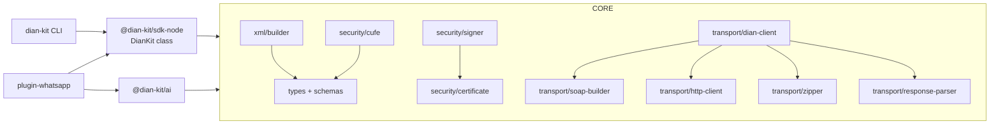
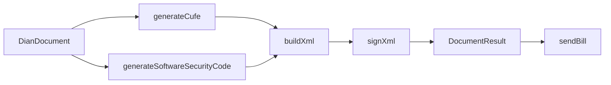

# System Patterns

## General Architecture

**Document pipeline** (orchestrated by `DianKit.processDocument`):

## Design Patterns

| Pattern | Where Used | Notes |
|---------|-----------|-------|
| Facade | `DianKit` class in sdk-node | Wraps core pipeline into simple methods |
| Builder | `xml/builder.ts` | Fluent XML construction via xmlbuilder2 |
| Strategy | `getDocumentConfig()` | Switches root element/namespace by doc type |
| Const objects as enums | `constants/*.ts` | `as const` objects with derived union types |
| Schema-first validation | `schemas/common.schema.ts` | Zod schemas mirror TypeScript interfaces |
| Custom error class | `DianTransportError` | Extends Error with statusCode + rawResponse |

## Code Conventions

- **Files**: kebab-case (`dian-client.ts`, `common.schema.ts`)
- **Functions**: camelCase, exported and pure where possible
- **Types/Interfaces**: PascalCase (`DianDocument`, `CertificateData`)
- **Constants**: PascalCase objects with UPPER_SNAKE members (`DocumentType.FACTURA_VENTA`)
- **Formatter**: Biome (2 spaces, double quotes, semicolons, trailing commas)
- **Linter**: Biome recommended rules
- **Commits**: Conventional Commits (`feat(core): ...`, `fix(sdk-node): ...`)

## Directory Conventions

| Directory | Purpose |
|-----------|---------|
| `packages/*/src/` | Source code (TypeScript) |
| `packages/*/tests/unit/` | Unit tests (Vitest) |
| `packages/*/dist/` | Build output (gitignored) |
| `docs/technical-reference/` | DIAN XML specifications |
| `examples/` | Usage examples (stubs) |

## Error Handling

- `DianTransportError` for all HTTP/SOAP/network failures (includes `statusCode`, `rawResponse`)
- Descriptive Spanish error messages for developer-facing errors (DIAN audience is Colombian)
- Validation errors via Zod `safeParse` returning structured error objects
- Certificate errors throw with guidance on common issues (wrong password, missing key)

## Anti-Patterns to Avoid

- Never log or serialize private keys (enforced in `certificate.ts` and `signer.ts`)
- Never round monetary values for CUFE/CUDE; always truncate (prevents CAD06/FAD06 rejections)
- Never send data to third-party servers; all communication is directly with DIAN endpoints
